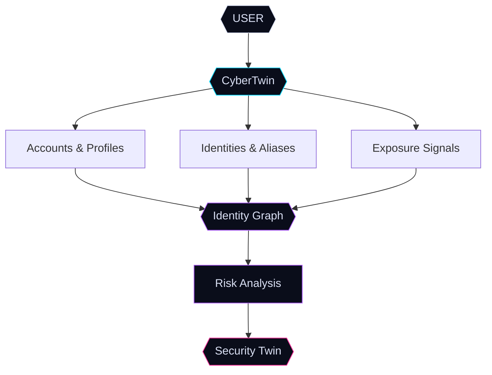
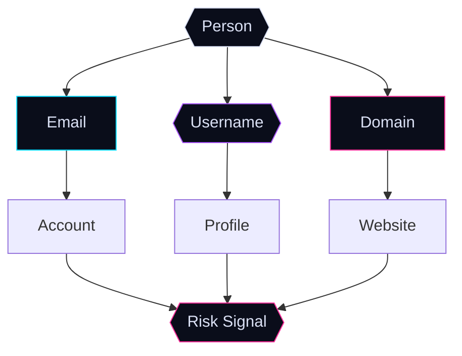
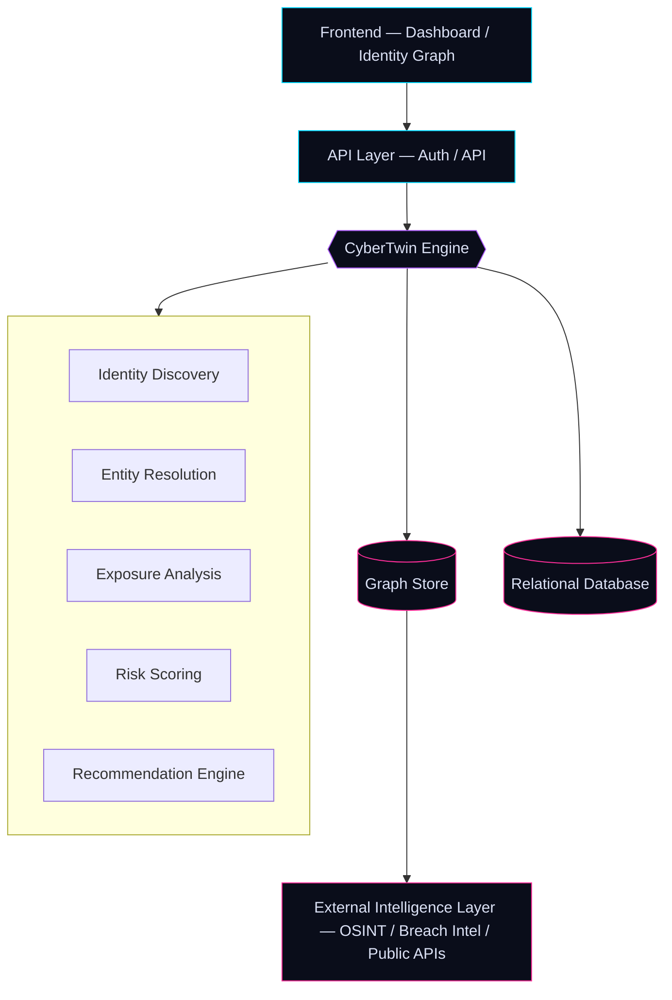

<div align="center">


<br/>


<br/>

<code>[ <a href="#the-problem">PROBLEM</a> ]</code>
<code>[ <a href="#the-cybertwin-concept">CONCEPT</a> ]</code>
<code>[ <a href="#core-features">FEATURES</a> ]</code>
<code>[ <a href="#proposed-architecture">ARCHITECTURE</a> ]</code>
<code>[ <a href="#development-roadmap">ROADMAP</a> ]</code>
<code>[ <a href="#privacy--ethics">PRIVACY</a> ]</code>

</div>


## ▸ Overview

**CyberTwin** is a cybersecurity platform that builds a security-focused **digital twin** of a person's online identity.

Every account, username, email address, public profile, exposed credential, device, and piece of publicly accessible information contributes to a person's **digital attack surface**. CyberTwin maps these fragments into one unified model — showing what the internet knows about someone, how the pieces connect, and where the risk actually is.

Instead of protecting a single device or account, CyberTwin protects the **digital representation of the person behind them**.

<br/>

## Try the live demo

[Open CyberTwin on GitHub Pages](https://srivastavaprisha29-ops.github.io/CyberTwin/#demo)

1. Select an account or exposure in Alex Rivera’s fictional identity graph.
2. Read how the selected signal contributes to the illustrative score.
3. Toggle a protective action, such as enabling email MFA, and watch the score update from **63/100 to 33/100**.
4. Select **Download report** to save your before-and-after score and remaining priorities.
5. Select **Reset example** to restore the starting state.

The demo runs in your browser with sample data. It requires no sign-in or personal information. The architecture and roadmap below describe future capabilities, including live exposure checks and monitoring.

### Run locally

Serve the repository with `python3 -m http.server 8000` and open `http://localhost:8000/land.html#demo`.

| File | Responsibility |
|---|---|
| `land.html` | Page structure and accessible demo controls |
| `styles.css` | Layout, visual styling, and animations |
| `demo.js` | Identity graph selection, risk scoring, and protective actions |

## ▸ The Problem

Digital identity is fragmented by default. A single person may have multiple email addresses, dozens of accounts, reused usernames, public profiles, exposed personal information, breached credentials, forgotten accounts, connected services, and publicly visible metadata.

Individually, each fragment looks harmless. Correlated, they can expose:

| ⬡ Risk | Example |
|---|---|
| Identity theft | Public bio + reused username reveals real identity |
| Phishing | Exposed email surfaces in a targeted campaign |
| Impersonation | Dormant account is cloned or hijacked |
| Credential attacks | Breached password reused across services |
| Social engineering | Public metadata used to build a pretext |
| Account takeover | Correlated reset flows chain together |
| Privacy invasion | Location + employer inferred from public posts |

Most security tools protect individual components. CyberTwin asks a different question:

> **What does my complete digital identity look like from a security perspective?**


## ▸ The CyberTwin Concept

CyberTwin builds a virtual security representation — a **Cyber Twin** — of a user's digital presence, continuously evolving as new signals appear.




## ▸ Core Features

**⬡ 01 — Digital Footprint Discovery**
Discovers and organizes publicly accessible information tied to a digital identity — usernames, email addresses, public profiles, websites, domains, account references, and exposed metadata — turning scattered information into a structured model.

**⬡ 02 — Identity Graph**
Discovered entities are represented as a connected graph, so relationships between pieces of identity become visible instead of staying isolated.



**⬡ 03 — Exposure Detection**
Flags exposure signals such as leaked credentials, exposed email addresses, forgotten accounts, suspicious identity reuse, publicly accessible sensitive information, and potentially compromised services.

**⬡ 04 — Digital Risk Score**
An interpretable score representing overall identity exposure — built from exposed-identity count, credential exposure, reuse indicators, account criticality, and entity relationships. The goal isn't just the number; it's explaining **why** the risk exists.


**⬡ 05 — Attack-Surface Simulation** <sub>· planned</sub>
Analyzes the identity graph from an attacker's perspective, tracing plausible paths before they're exploited:


**⬡ 06 — Security Recommendations**
Every detected risk resolves to a concrete next step — moving from **Detection → Understanding → Action**.

| Signal | Recommendation |
|---|---|
| Email found in known breach | Change credentials for the affected service |
| Username reused across platforms | Separate public and private identities |
| Excessive personal info exposed | Review privacy settings, remove what isn't needed |


## ▸ Proposed Architecture



<details>
<summary><b>⬡ Technology stack</b></summary>
<br/>


- **Frontend** — React / Next.js, TypeScript, Tailwind CSS, graph visualization libraries
- **Backend** — Python, FastAPI
- **Data** — PostgreSQL, graph database / graph-processing layer
- **Security & Intelligence** — OSINT integrations, breach intelligence APIs, identity correlation, risk-scoring engine
- **Infrastructure** — Docker, GitHub Actions, cloud deployment

</details>


## ▸ Development Roadmap

<details open>
<summary><b>⬡ Phase 01 — Foundation</b></summary>

- [ ] Repository architecture
- [ ] Backend API
- [ ] Frontend dashboard
- [ ] User authentication
- [ ] Database models
- [ ] Basic CyberTwin profile
</details>

<details>
<summary><b>⬡ Phase 02 — Identity Discovery</b></summary>

- [ ] Username discovery
- [ ] Email exposure analysis
- [ ] Public profile discovery
- [ ] Entity normalization
- [ ] Identity correlation
</details>

<details>
<summary><b>⬡ Phase 03 — CyberTwin Graph</b></summary>

- [ ] Identity graph model
- [ ] Entity relationships
- [ ] Interactive graph visualization
- [ ] Exposure nodes
- [ ] Graph exploration
</details>

<details>
<summary><b>⬡ Phase 04 — Risk Intelligence</b></summary>

- [ ] Risk scoring engine
- [ ] Exposure severity classification
- [ ] Security recommendations
- [ ] Attack-path analysis
- [ ] Risk dashboard
</details>

<details>
<summary><b>⬡ Phase 05 — Continuous CyberTwin</b></summary>

- [ ] Periodic exposure monitoring
- [ ] New-risk detection
- [ ] Security alerts
- [ ] Historical risk tracking
- [ ] CyberTwin evolution timeline
</details>


## ▸ Example CyberTwin

```text
CyberTwin: Example User

Digital Identities
├── Email Addresses
│   ├── primary@example.com
│   └── dev@example.com
│
├── Usernames
│   ├── exampledev
│   └── example_user
│
├── Accounts
│   ├── Developer Platform
│   ├── Community Platform
│   └── Personal Website
│
└── Exposure Signals
    ├── Email Exposure
    ├── Username Reuse
    └── Public Metadata

Risk Score: 42 / 100
Primary Risk: Identity correlation across multiple public accounts.
```

<br/>

## ▸ Privacy & Ethics

CyberTwin deals with security-sensitive information, so privacy and responsible use are fundamental design principles, not add-on features.

- **User control** — users stay in control of their CyberTwin and its data
- **Data minimization** — only what's necessary for legitimate security analysis is collected or stored
- **Transparency** — every risk signal traces back to where it came from and why it matters
- **Defensive use only** — for personal cybersecurity, privacy awareness, and authorized security analysis

CyberTwin must not be used for unauthorized surveillance, harassment, credential theft, stalking, or attacks against third parties.

<br/>

## ▸ Vision

Traditional security asks *"is my device secure?"* CyberTwin asks:

> **Is my digital identity secure?**

As identity becomes distributed across platforms, devices, services, and data ecosystems, protecting individual accounts stops being enough. CyberTwin aims to build a living security model that understands the whole picture.

<br/>

## ▸ Contributing

CyberTwin is in early development — contribution guidelines will land as the architecture stabilizes. Ideas, security research, and architectural discussion are welcome in the meantime.

<div align="center">
<sub>Project status: <b>Early Development / Experimental</b> — architecture, APIs, and models are expected to change.</sub>
</div>


